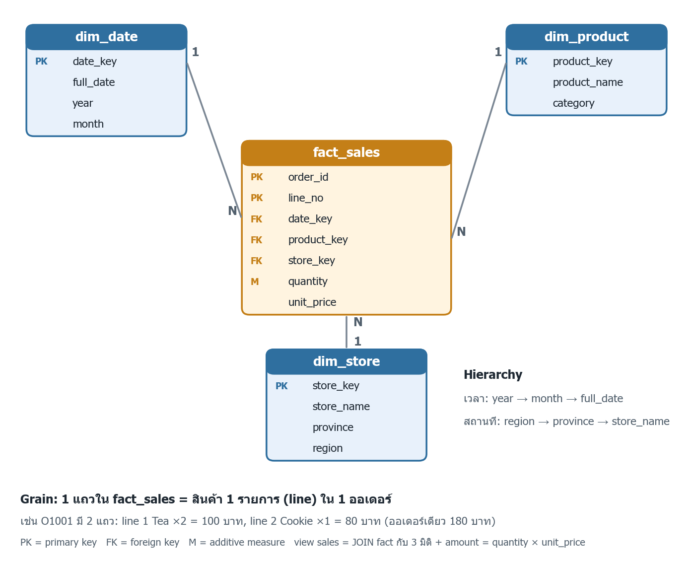

# รายงานแลป OLTP OLAP และ Pivot

ชื่อ: กนกภัทร พุ่มห้วยรอบ รหัส: 67160174 กลุ่ม: 1

ข้อมูล `warehouse.db`: 8 รายการ, 6 ออเดอร์, 1,390 บาท (ผลรันทุกข้ออยู่ใน `results/`)

## 1 OLTP

```python
cur=con.execute("UPDATE orders SET status='PAID' WHERE order_id=? AND status='PENDING'",('O1004',))
```

| รอบ | Before  | rowcount | After |
| ------ | ------- | -------- | ----- |
| 1      | PENDING | 1        | PAID  |
| 2      | PAID    | 0        | PAID  |

- **รอบ 2 ได้ 0 แถว** เพราะสถานะเป็น PAID แล้ว ไม่ตรง `status='PENDING'`
- **ต้องเช็ก status** กันการเปลี่ยนสถานะผิด (เช่น CANCELLED → PAID) และรันซ้ำได้ปลอดภัย
- **เป็น OLTP** เพราะเป็นธุรกรรมสั้น แก้ข้อมูล 1 แถว SELECT แค่เช็กสถานะ ไม่ได้สรุปข้อมูล
- **warehouse.db ไม่เปลี่ยน** เพราะเป็นคนละฐาน ต้องใช้ **ETL** ดึงข้อมูลเข้า warehouse

## 2 Grain และ Star Schema



- **Grain:** 1 แถว = สินค้า 1 รายการใน 1 ออเดอร์ (O1001 มี 2 แถว: Tea, Cookie)
- **PK/FK:** fact_sales PK (order_id, line_no), FK date_key / product_key / store_key → มิติแบบ 1:N
- **Dimensions:** date, product, store | **Measures:** quantity, amount
- **Hierarchy:** year → month → date | region → province → store
- **ห้ามบวก unit_price** เพราะเป็นราคาต่อชิ้น บวกได้ 520 ไม่มีความหมาย ยอดจริงคือ SUM(quantity × unit_price) = 1,390

**q01:** รายการ **8** ออเดอร์ **6** ชิ้น **23** ยอดขาย **1,390** บาท (ตรงกับ warehouse.csv)

## 3 OLAP

| ไฟล์ | Operation                      | ผล                                               |
| -------- | ------------------------------ | -------------------------------------------------- |
| q02      | Roll-up รายเดือน       | ส.ค. 490, ก.ย. 900                             |
| q03      | เดือน × จังหวัด   | ส.ค. BKK 310 / CBI 180, ก.ย. BKK 540 / CBI 360 |
| q04      | Drill-down รายวัน ก.ย. | 360, 300, 240                                      |
| q05      | Slice ก.ย.                   | BKK 540, CBI 360                                   |
| q06      | Dice ก.ย. + Drink + BKK/CBI  | BKK 300, CBI 200                                   |
| q07      | ก.ย. ยอด > 400            | BKK 540                                            |
| q12      | Drill-through BKK ก.ย.       | O1005 Tea 300, O1006 Cookie 240                    |

**จุดตรวจ:** 490 + 900 = 1,390 และรายวัน ก.ย. 900 = Slice ก.ย. 900

- **ก.** q03 เพิ่มมิติใหม่ (จังหวัด) ส่วน q04 ลงรายละเอียดในมิติเดิม (เดือน → วัน)
- **ข.** กรองเดือนใน WHERE (ก่อนรวม) กรอง SUM > 400 ใน HAVING (หลังรวม)
- **ค.** q12 รวม 300 + 240 = 540 = ช่อง ก.ย. × Bangkok ใน q03

## 4 Pivot

| province | ส.ค. | ก.ย. | Total |
| -------- | ------ | ------ | ----- |
| Bangkok  | 310    | 540    | 850   |
| Chonburi | 180    | 360    | 540   |
| Total    | 490    | 900    | 1,390 |

- **q08 และ P1** ได้ตารางเดียวกัน, assert Total × Total = 1,390 ผ่าน
- **P2 ก.ย.:** Drink BKK 300 / CBI 200, Snack BKK 240 / CBI 160
- **ไม่ใส่ aggfunc** pandas ใช้ mean → Bangkok ก.ย. = (300 + 240) / 2 = **270** (ค่าเฉลี่ยต่อรายการ) แก้เป็น sum ได้ **540**
- **Drink** (ใช้ pandas แทน Excel): Rows = province, Columns = month, Values = Sum(amount) ยอดรวม **750** บาท
- **sum กับ mean:** sum = ยอดรวม บวกต่อได้ / mean = ค่าเฉลี่ย บวกต่อไม่ได้
- **ถ้ามีตุลาคม:** SQL CASE ไม่เพิ่มคอลัมน์ให้เอง (แต่ total รวมตุลาคมไปแล้ว ยอดเลยไม่ตรง) ส่วน pandas เพิ่มคอลัมน์ให้อัตโนมัติ

## 5 ตรวจความถูกต้อง

- **q09:** ส.ค. 490, ก.ย. 900, ALL 1,390 — ถ้าบวกทุกแถวอีกรอบได้ 2,780 (นับซ้ำ)
- **q10:** AOV = 1,390 / 6 = **231.67 บาท/ออเดอร์**, AVG(amount) = **173.75 บาท/รายการ** (ต้อง × 1.0 ไม่งั้น SQLite ปัดเหลือ 231)
- **q11:** ก่อนและหลัง JOIN = 8 แถว / 1,390 บาท, FK ผิด 0 → ถ้าคีย์มิติซ้ำ ยอดจะเกิน, ถ้า FK หาย ยอดจะหาย

| ชนิด      | ตัวอย่าง         | วิธีรวม                                                              |
| ------------- | ------------------------ | --------------------------------------------------------------------------- |
| Additive      | amount                   | SUM ได้ทุกมิติ                                                    |
| Semi-additive | สต็อกสิ้นวัน | ข้ามเวลาห้ามบวก ใช้ค่าวันสุดท้าย             |
| Non-additive  | AOV                      | คำนวณใหม่: ยอดรวม / จำนวนออเดอร์ทั้งช่วง |

## 6 สรุป

- **ข้อค้นพบ 1:** ยอด ก.ย. 900 สูงกว่า ส.ค. 490 (+84%) แต่บอกไม่ได้ว่าเพราะโปร 9.9
- **ข้อค้นพบ 2:** Bangkok ขายมากสุด 850 บาท (61%) และ Drink ขายดีกว่า Snack (750 กับ 640)
- **ข้อจำกัด:** ข้อมูลน้อยมาก (8 รายการ) และเป็นข้อมูลจำลอง

**การใช้ AI** ใช้ Claude Code ช่วยเขียน SQL, โค้ด pandas
prompt สำคัญ: "read week 9 and explain the work, What i have to do and what req to submit this work with example"

## โจทย์ต่อยอด

- **ก.** 3 สาขายอดสูงสุด: Nimman 145,280 / Pattaya 141,215 / Muang Rayong 136,710
  AOV ทั้งช่วง 448.86 แต่เฉลี่ย AOV รายเดือนได้ 449.05 เพราะแต่ละเดือนมีจำนวนออเดอร์ไม่เท่ากัน
- **ข.** เพิ่ม O1007, O1008 ใน challenge.db: 8 → 11 แถว, 6 → 8 ออเดอร์, 1,390 → 1,900 บาท ก่อนและหลัง JOIN ตรงกัน
